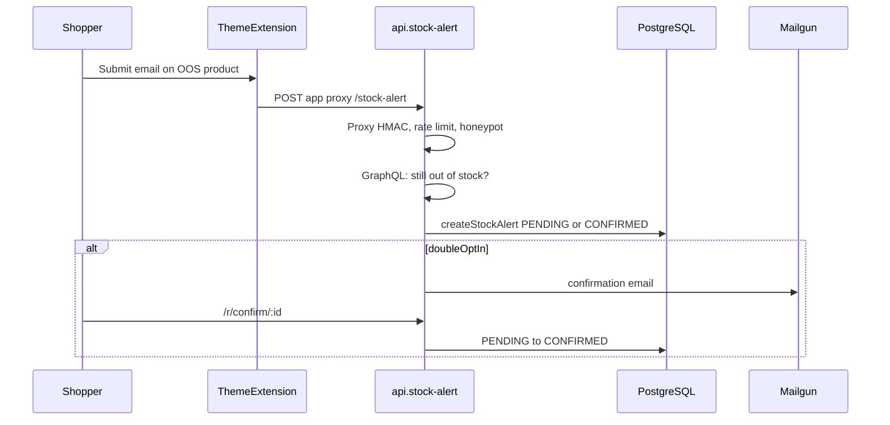
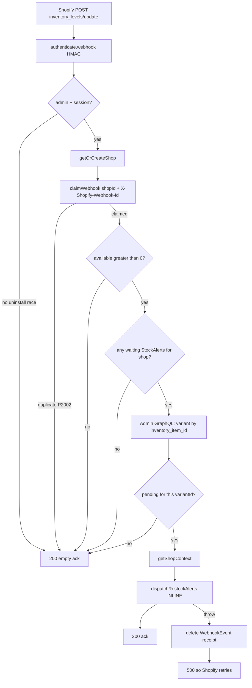
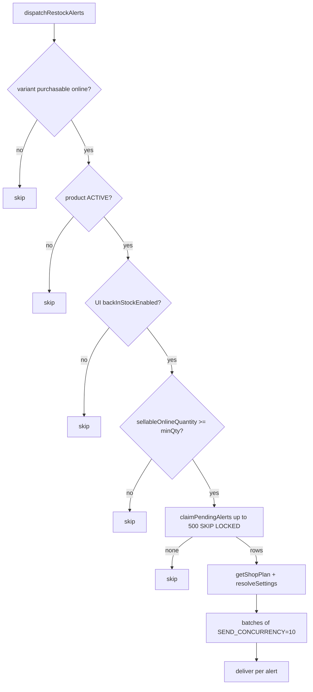
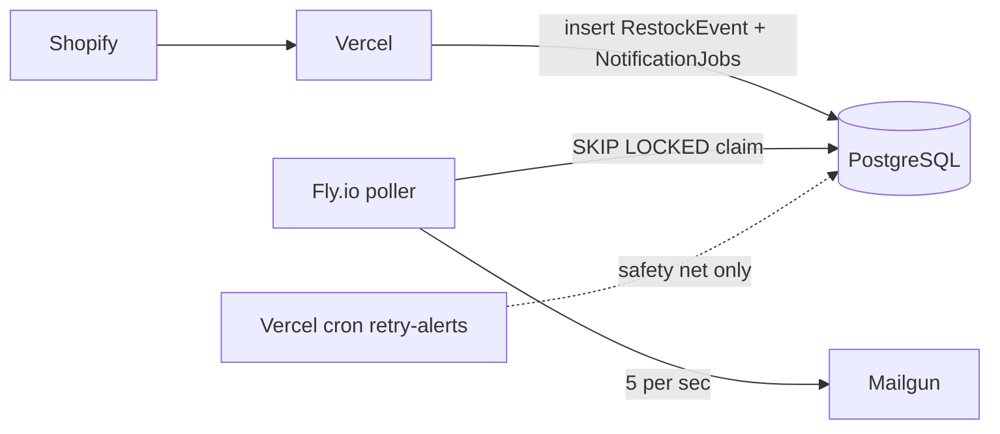
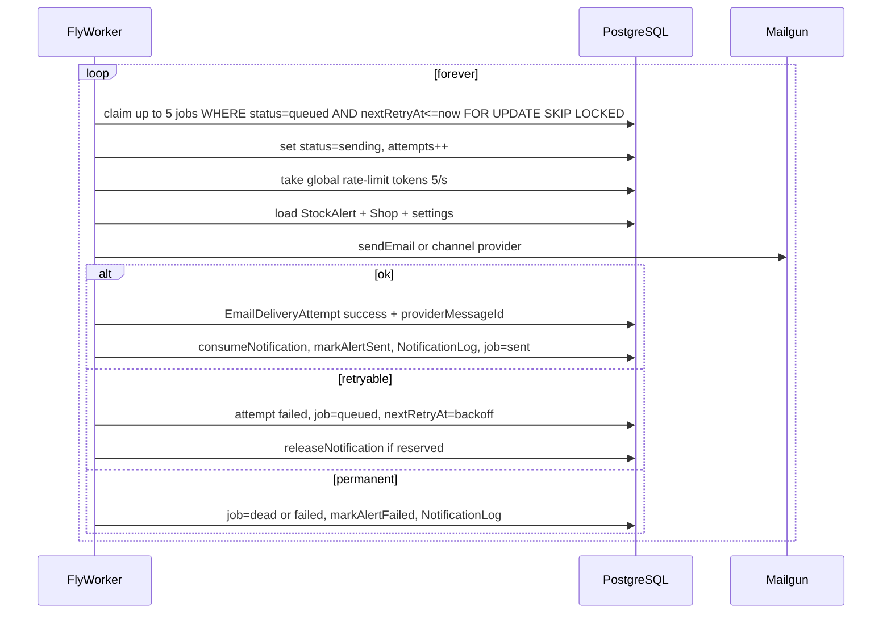

# Restock notification — complete flow notes

Last updated: 2026-10-29  
Scope: how back-in-stock emails move through the system **today**, and under the **production queue** (Vercel enqueue + Outbox → SQS → ECS workers at ~20 emails/s).  
Feature flag: `RESTOCK_QUEUE_ENABLED=true` or `Shop.restockQueueEnabled`.  
Infra: [`infra/restock-queue/`](../infra/restock-queue/). Worker: `npm run worker:restock`.

---

## 0. Actors and stores of truth

| Piece | Role |
|---|---|
| Shopify Admin | Emits `inventory_levels/update` and `products/update` webhooks |
| Vercel (Remix app) | HMAC verify, shop resolve, webhook receipt, eligibility, enqueue (target) or send (today) |
| PostgreSQL | Source of truth for shops, subscribers, jobs, quota, delivery logs |
| Mailgun | Actual email send API |
| Fly.io worker (target) | Long-lived poller that claims jobs and calls Mailgun |
| Vercel cron `/api/cron/retry-alerts` | Safety net for stuck PENDING / stale SENDING alerts |
| Theme app extension | Customer signup UI → app proxy `stock-alert` |

**Primary tables today**

- `StockAlert` — one subscription row (statuses: PENDING → CONFIRMED? → SENDING → SENT \| FAILED \| CANCELLED)
- `WebhookEvent` — dedupe Shopify deliveries (`@@unique([shopId, webhookId])`)
- `UsageCounter` / `UsageLedger` — plan quota reserve → consume \| release
- `NotificationLog` — analytics / audit of restock sends
- `Shop`, `Plan`, `UIConfig` — feature flags, email settings, min stock, templates

**Tables added for free-tier queue**

- `RestockEvent` — one logical restock cycle per shop/variant
- `NotificationJob` — one durable send unit (links restock ↔ alert)
- `EmailDeliveryAttempt` — per provider call outcome (+ message id)

---

## 1. Customer subscribe flow (unchanged by queue work)



Key files:

- [`extensions/theme/assets/back-in-stock.js`](../extensions/theme/assets/back-in-stock.js)
- [`app/routes/api.stock-alert.tsx`](../app/routes/api.stock-alert.tsx)
- [`app/models/stock-alert.server.ts`](../app/models/stock-alert.server.ts)
- Confirm: [`app/routes/r.confirm.$id.tsx`](../app/routes/r.confirm.$id.tsx)

Waiting statuses used by restock dispatch:

- Double opt-in **on**: `PENDING` + `CONFIRMED` (only confirmed should get restock email in claim path when `onlyConfirmed` is true — `claimPendingAlerts(..., shop.doubleOptIn)`).
- Double opt-in **off**: `PENDING` only.

---

## 2. Current production restock flow (inline send)

**Problem this free plan solves:** Mailgun runs **inside** the Shopify webhook request. Large bursts hit Vercel duration limits, slow acks, and Shopify redeliveries.

### 2.1 Entry: `inventory_levels/update`

File: [`app/routes/webhooks.inventory.tsx`](../app/routes/webhooks.inventory.tsx)



Short-circuits (ack 200, no send):

1. No admin/session (uninstalled).
2. Duplicate webhook id for shop.
3. `available <= 0`.
4. Zero waiting alerts for the shop.
5. Cannot resolve variant from inventory item.
6. Zero waiting alerts for that `variantId`.

### 2.2 Entry: `products/update` (safety net)

File: [`app/routes/webhooks.products.update.tsx`](../app/routes/webhooks.products.update.tsx)

Catches restocks that do not move inventory levels (continue selling, draft→active, etc.).

1. HMAC + `claimWebhook`.
2. Require product `status === active`.
3. Find distinct `variantId`s with waiting alerts for this `productId`.
4. Intersect with payload variants; GraphQL load; filter purchasable (`availableForSale` && `sellableOnlineQuantity > 0`).
5. For each purchasable variant → **`dispatchRestockAlerts` inline**.
6. On throw → release webhook receipt → 500.

### 2.3 Core: `dispatchRestockAlerts`

File: [`app/lib/notifications/dispatch.server.ts`](../app/lib/notifications/dispatch.server.ts)



**`claimPendingAlerts`** ([`stock-alert.server.ts`](../app/models/stock-alert.server.ts)):

- Selects PENDING/(CONFIRMED) or **stale SENDING** (abandoned mid-flight).
- Sets status `SENDING`, increments `attempts`, `FOR UPDATE SKIP LOCKED`.
- Batch size default **500**.

**`deliver` (per alert) today:**

1. Build template vars (product, price, URLs, tracking `/r/alert/:id`, unsubscribe).
2. Channel gates (email off / SMS-WhatsApp plan / toggles) → `holdAlertForQuota` → stay PENDING.
3. If email counts toward plan quota → `reserveNotification`:
   - `exceeded` → hold PENDING
   - `already_consumed` → `markAlertSent` (idempotent success)
   - `reserved` → continue
4. `sendEmail` / `sendSms` / `sendWhatsApp` via providers.
5. Fail → `releaseNotification` if reserved → `markAlertFailed` (FAILED after 3 attempts else PENDING) → `NotificationLog` failed.
6. Success → `consumeNotification` → `markAlertSent` → `NotificationLog` sent.

### 2.4 Retry / safety net (today)

| Trigger | Behavior |
|---|---|
| Cron `POST /api/cron/retry-alerts` + `CRON_SECRET` | Per shop: `retryStuckAlerts(includeFailed: false)` — re-runs **same** `dispatchRestockAlerts` for variants still owed a send |
| Admin “Retry failed & stuck” | Same path with `includeFailed: true` (reactivates FAILED) |
| Shopify redelivery after 500 | New attempt only if webhook receipt was deleted |

`retryStuckAlerts` still sends **inline** inside the cron request — same burst risk.

---

## 3. Target free-tier flow (approved)

**Goal:** Webhook only **records work**. Fly worker **sends** at ~5 emails/s. Same `NotificationJob` model later feeds SQS/ECS.



Feature flag: `RESTOCK_QUEUE_ENABLED` (env and/or per-shop). When off, keep today’s inline path.

### 3.1 Webhook intake (enqueue-only when flag on)

Same steps as §2.1 / §2.2 through eligibility and GraphQL variant resolve.

**Replace** `dispatchRestockAlerts` send loop with **`enqueueRestockAlerts`**:

1. **Upsert `RestockEvent`**
   - Key idea: one open cycle per `(shopId, variantId)` while stock remains eligible, or a cycle id derived from webhook/inventory snapshot so duplicate inventory ticks do not create a second blast for the same restock.
   - Fields (logical): `shopId`, `variantId`, `inventoryItemId?`, `available`, `sellableOnlineQuantity`, `status` (`open` \| `enqueued` \| `completed` \| `cancelled`), `createdAt`.
2. **Page `StockAlert` subscribers** still waiting (do **not** flip all to SENDING in the webhook).
3. **Batch insert `NotificationJob`**
   - Unique: `(shopId, restockEventId, stockAlertId)` — duplicate webhook / overlapping inventory+products handlers create **zero** duplicate jobs.
   - Status: `queued`
   - Optional: reserve quota at enqueue time **or** at worker claim time (prefer **worker** for “held” quota fairness; if reserved at enqueue, reuse `reserveNotification` per job in bounded batches).
4. **Ack Shopify 200 immediately** — no Mailgun, no `SEND_CONCURRENCY` loop.
5. On handler throw before durable enqueue commit → delete `WebhookEvent` → 500 (same as today). After jobs are committed, ack success even if worker is down (jobs wait in DB).

**Decision committed for free path:** reserve quota in the **worker** when claiming/sending (mirrors today’s `deliver` order). Enqueue does not burn allowance for jobs that never send. Jobs held by quota stay `queued` / move to `held` with `nextRetryAt`.

### 3.2 Worker poll loop (Fly.io)

Process: `npm run worker:restock` → `app/workers/restock-poller.server.ts`  
Infra: 1 Fly machine, always-on, shared secrets (`DATABASE_URL`, Mailgun env, etc.)



**Claim SQL shape (conceptual):**

```sql
UPDATE "NotificationJob"
SET status = 'sending', attempts = attempts + 1, "updatedAt" = NOW()
WHERE id IN (
  SELECT id FROM "NotificationJob"
  WHERE status IN ('queued') AND ("nextRetryAt" IS NULL OR "nextRetryAt" <= NOW())
  ORDER BY "createdAt" ASC
  LIMIT 5
  FOR UPDATE SKIP LOCKED
)
RETURNING *;
```

Also recover stale `sending` jobs older than N minutes (same idea as stale SENDING on `StockAlert`).

**Rate limit:** one Postgres row (token bucket) or advisory lock + in-process tokens on the single Fly machine. Global cap **5 emails/s**. In-flight concurrency **5**.

**`deliverOne`:** extract today’s `deliver()` so webhook inline path and worker share one implementation until inline is removed.

### 3.3 Job + alert status mapping

| NotificationJob.status | Meaning | StockAlert effect |
|---|---|---|
| `queued` | Waiting for worker | Unchanged (PENDING/CONFIRMED) until send starts |
| `sending` | Claimed by worker | Optionally mirror SENDING, or leave until success |
| `sent` | Provider accepted | `SENT` + `notifiedAt` |
| `held` | Plan quota / channel off | Stay PENDING with `lastError` |
| `failed` | Soft fail, will retry | PENDING if attempts &lt; max |
| `dead` | Exhausted retries / bad address | `FAILED` |

Prefer updating `StockAlert` only on terminal or hold outcomes so crash mid-send does not strand alerts without a job row. Job row is the queue source of truth.

### 3.4 Cron under free tier

[`api.cron.retry-alerts`](../app/routes/api.cron.retry-alerts.tsx) stays as backstop:

- Finds variants with waiting alerts **and no open/queued job** for current restock (orphan repair), **or**
- Continues to call enqueue (not inline send) when flag on.

Must **not** become a second uncontrolled Mailgun sender for 100k rows inside one Vercel invocation.

### 3.5 Capacity (free)

| Knob | Value |
|---|---|
| Workers | 1 |
| Concurrency | 5 |
| Send rate | 5/s |
| ~100k ideal drain | ~5.5 hours (no retries) |

---

## 4. Idempotency map

| Event | Key | Behavior |
|---|---|---|
| Shopify webhook delivery | `(shopId, webhookId)` on `WebhookEvent` | Second delivery no-ops |
| Logical notification | `(shopId, restockEventId, stockAlertId)` on `NotificationJob` | Unique insert; conflict = skip |
| Plan quota unit | `UsageLedger.idempotencyKey` = `stockAlertId:notifyGeneration` | reserved → consumed \| released; `already_consumed` ⇒ treat as sent |
| Provider ambiguous timeout | `EmailDeliveryAttempt.providerMessageId` | Do not blindly double-send; check prior success attempt |

---

## 5. Failure matrix

| Failure | Today | Free-tier target |
|---|---|---|
| Duplicate Shopify webhook | `claimWebhook` false → 200 | Same |
| Handler crash before send | Delete receipt → 500 → Shopify retry | Delete receipt only if enqueue not committed; else jobs remain |
| Handler crash mid-send | Alerts may be SENDING; stale reclaim + Shopify retry risk | Jobs stay `queued`/`sending`; worker reclaim; webhook already acked |
| Worker crash mid-send | N/A | Stale `sending` → requeue after visibility window |
| Mailgun 429 / outage | Fail alert; cron/retry later | Backoff `nextRetryAt`; reduce effective rate |
| Invalid email | FAILED after 3 attempts | Job `dead`; alert FAILED; no infinite retry |
| Quota exceeded | Hold PENDING | Job `held` + `nextRetryAt`; alert PENDING |
| DB down | Webhook 500 | Webhook 500; worker pauses; jobs durable once written |
| Inventory goes OOS again | Next inventory event short-circuits | Cancel open `RestockEvent` / skip jobs if re-check fails before send |
| Fly machine asleep/stopped | N/A | Jobs pile in DB; cron cannot replace full drain — keep machine always-on |

---

## 6. Post-send shopper flows (unchanged)

| Path | File | Purpose |
|---|---|---|
| Click CTA | `/r/alert/:id` | Track click / redirect to product or cart permalink |
| Unsubscribe | alert unsubscribe URL | Cancel subscription |
| Purchase attribution | order webhooks + analytics | `convertedAt` / attribution models |

---

## 7. Later upgrade (not this phase)

Keep `NotificationJob` rows. Add:

1. Transactional **Outbox** → Amazon **SQS** Standard + DLQ  
2. **ECS Fargate** workers (2–10) reading SQS by job id  
3. Distributed rate limit **20 emails/s**  
4. Fair-share multi-shop scheduling  

No second job schema.

---

## 8. Implementation checklist (free path)

1. Document flows — **this file**.
2. Prisma: `RestockEvent`, `NotificationJob`, `EmailDeliveryAttempt` + indexes + migration.
3. Extract `deliverOne`; add `enqueueRestockAlerts`; gate webhooks with `RESTOCK_QUEUE_ENABLED`.
4. Fly poller + Postgres claim + 5/s limiter + stale reclaim.
5. Adjust cron to enqueue-or-repair, not bulk inline send when flag on.
6. Staging: mock Mailgun, duplicate webhooks, kill worker, quota hold.
7. Flagged production rollout per shop or global env.

---

## 9. File index

| Concern | Path |
|---|---|
| Inventory webhook | `app/routes/webhooks.inventory.tsx` |
| Products webhook | `app/routes/webhooks.products.update.tsx` |
| Dispatch / deliver | `app/lib/notifications/dispatch.server.ts` |
| Providers | `app/lib/notifications/providers.server.ts` |
| Webhook dedupe | `app/lib/webhook-events.server.ts` |
| Alert claim / status | `app/models/stock-alert.server.ts` |
| Quota | `app/lib/billing/usage.server.ts` |
| Retry cron | `app/routes/api.cron.retry-alerts.tsx` |
| Schema | `prisma/schema.prisma` |
| Worker (to add) | `app/workers/restock-poller.server.ts` |
| Subscribe API | `app/routes/api.stock-alert.tsx` |
